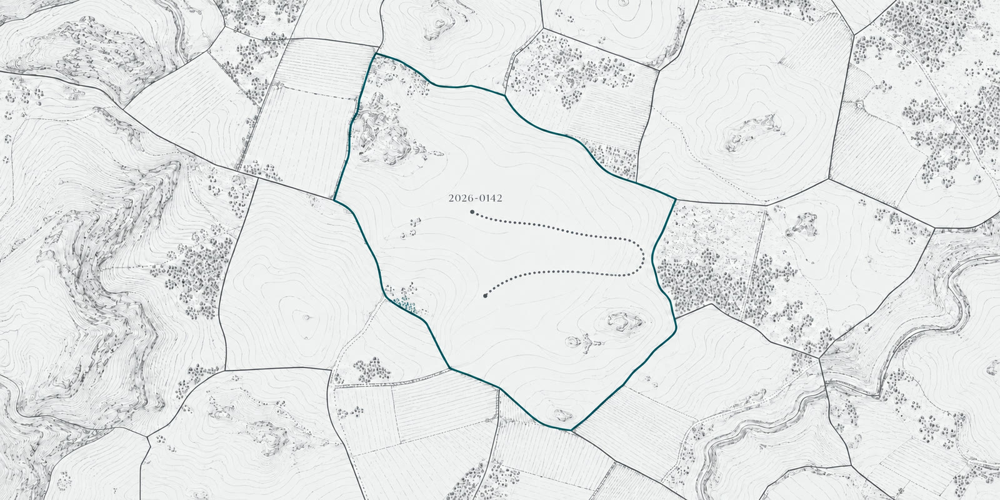

# Identity voor AI-agents

{.kop}

**Gedelegeerde toegang, intrekking en audit voor een AI-agent bij de overheid.**

Michael Owen Meijer, Oomny B.V. · identity-architect en AI-engineer voor overheid en cloud

## Het probleem

AI-agents krijgen toegang tot dossiers, mailboxen en vakapplicaties. Vaak met het token van de
gebruiker, een gedeeld API-geheim of een serviceaccount met brede rechten. Dan kan een
gemanipuleerde agent alles wat die identiteit kan, en ziet niemand achteraf wie wat deed.

## De aanpak

Een agent krijgt dezelfde identity-zorg als een medewerker:

- **Eigen identiteit.** De agent is een eigen client met een sleutel in plaats van een gedeeld
  geheim. In Entra: een agent identity met sponsor, zonder geheim via een managed identity.
- **Mandaat per taak.** De medewerker geeft toestemming voor één agent en één taak. Per actie
  krijgt de agent een token met alleen de rechten voor die ene tool, 60 seconden geldig,
  eenmalig te gebruiken en gebonden aan zijn sleutel (OAuth 2.0 Token Exchange, DPoP).
- **Nooit meer dan de mens.** De API laat alleen toe wat agent, medewerker en taak alle drie mogen.
  Een agent legt nooit een besluit vast.
- **Intrekbaar.** De medewerker trekt het mandaat in en de volgende actie faalt, ook met vooraf
  opgehaalde tokens. De beheerder heeft een noodstop.
- **Auditspoor.** Elke actie en elke weigering door de API staat in een hashketen met een apart
  anker: wie, namens wie, welke tool, welk dossier, welk token, waarom. Weigeringen door Keycloak
  staan in de Keycloak-events.

## Het bewijs

Een publieke repo met een werkende demo in één commando (`make demo`). Een LangGraph-agent
werkt via MCP op een dossier-API van een fictieve gemeente. In het tweede scenario simuleert de
demo een agent die een ingevoegde instructie uit een dossier volgt, en de grens houdt: Keycloak weigert het token
voor een besluit, en de API weigert het dossier buiten het mandaat.

50 integratietests tegen de echte keten. Een dreigingsmodel tegen de OWASP Top 10 for Agentic
Applications 2026 en de OWASP Non-Human Identities Top 10, met per risico de test die het bewijst.
Een eerlijke paragraaf over wat dit niet oplost.

Keycloak 26.8 (open source) en Microsoft Entra Agent ID naast elkaar, met Terraform voor de
Entra-kant (gevalideerd, niet in een tenant uitgerold).

## Waarom van mij

Identity en security sinds 2011, bijna acht jaar voor de vier grote gemeenten: federatie,
Keycloak, Entra ID, en de overstap van persoonlijke tokens naar managed identities. Sinds 2026
bouw ik AI-agents met tool calling en MCP. Het snijvlak is precies waar overheden nu staan:
agents toelaten zonder de controle over toegang kwijt te raken.

**Repo:** [INVULLEN: repo-URL na publicatie] · **Site:** www.oomny.nl · **Mail:** michael@oomny.nl
